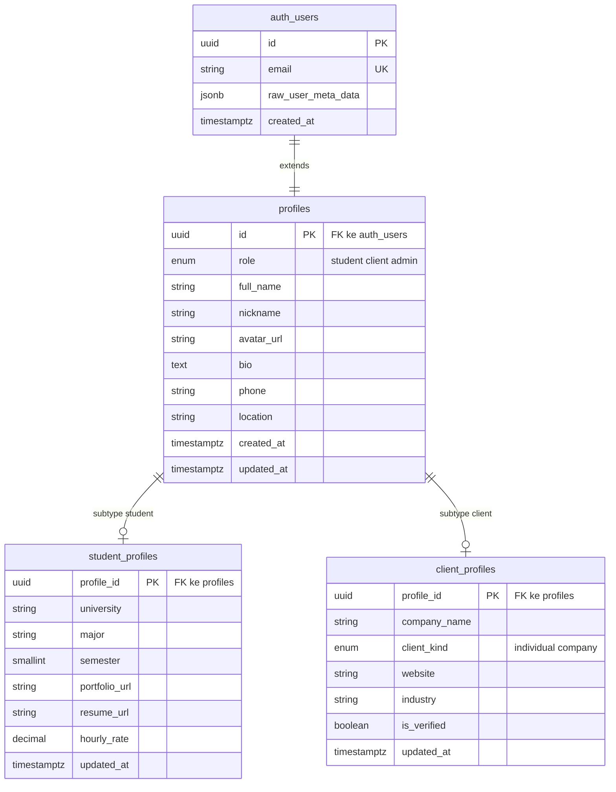
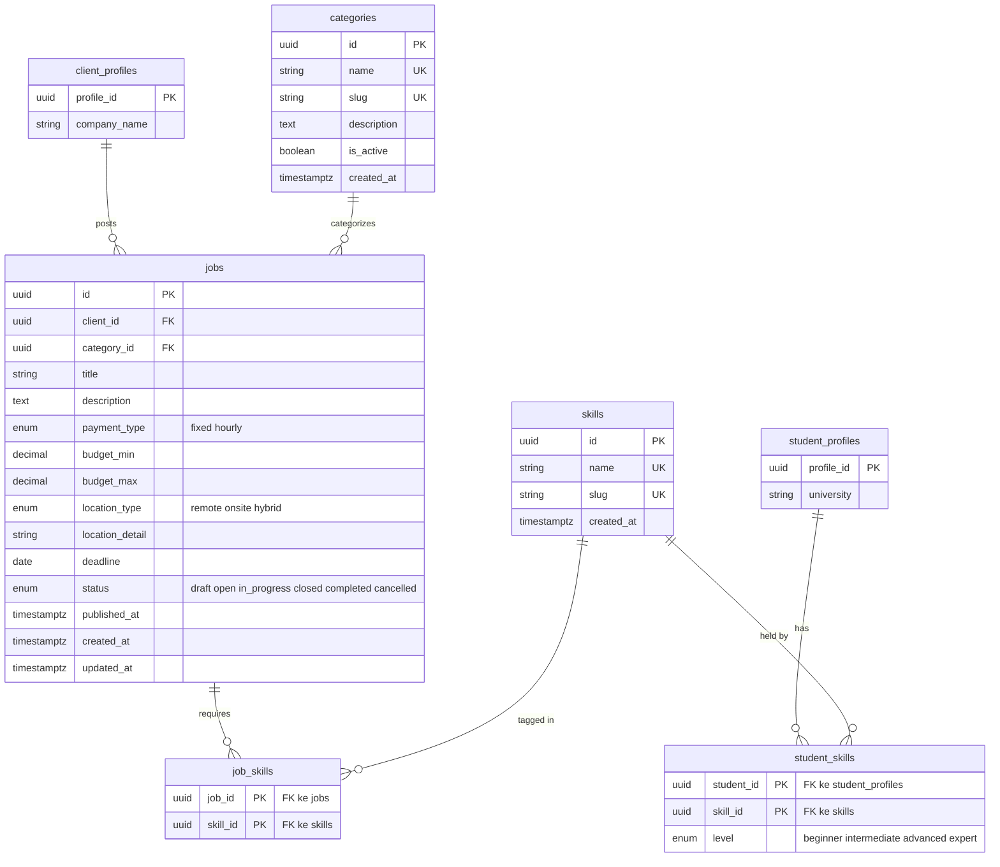
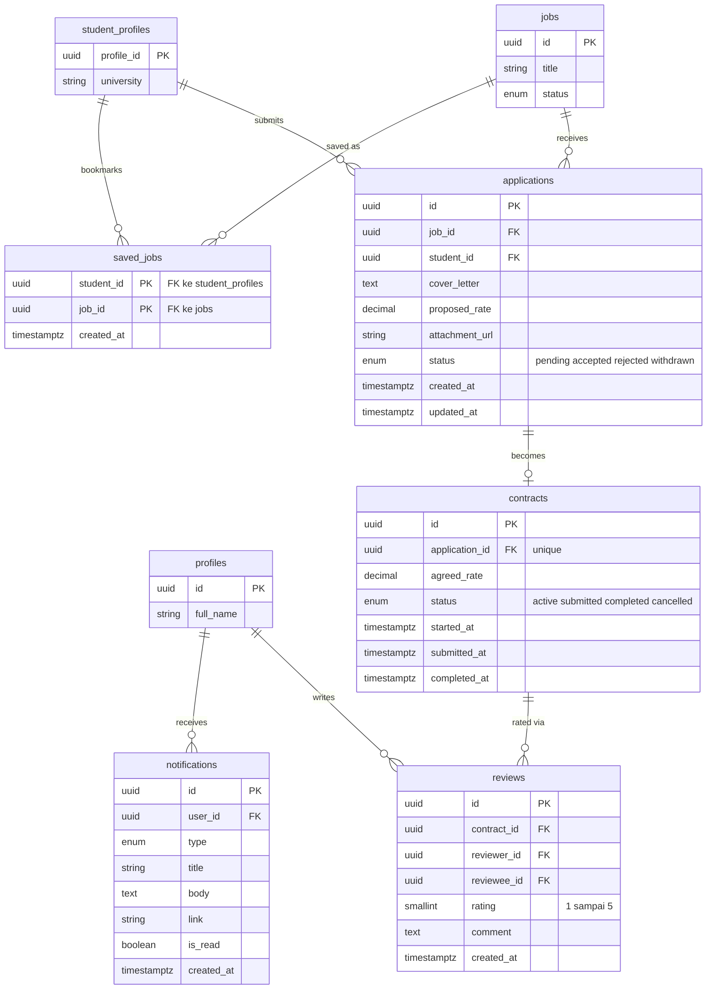
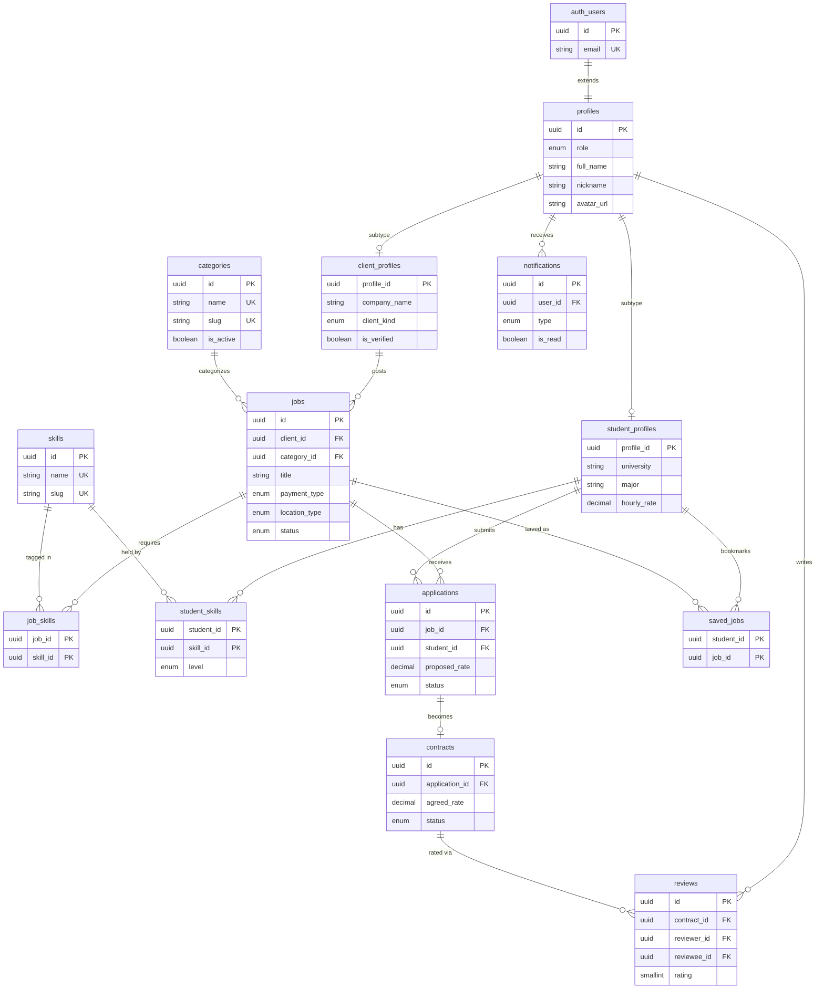

## 2. ERD (Entity Relationship Diagram)

Skema dipecah menjadi tiga diagram per kelompok agar terbaca jelas.
Diagram utuh ada di [bagian 2.4](#24-diagram-utuh).

### 2.1 Kelompok Identitas

### 2.2 Kelompok Katalog & Lowongan

### 2.3 Kelompok Transaksi & Pendukung

### 2.4 Diagram Utuh

Semua tabel dan relasi dalam satu diagram. Kolom sengaja diringkas agar
tetap terbaca. Untuk melihat versi yang bisa di-zoom dan digeser, salin
blok di bawah ke [mermaid.live](https://mermaid.live).

> [!NOTE]
> Nama `auth_users` ditulis dengan garis bawah karena Mermaid tidak menerima
> titik pada nama entitas. Nama aslinya `auth.users` — tabel bawaan Supabase
> di skema `auth`, bukan `public`.

> [!NOTE]
> Mermaid hanya mengenal tiga penanda kunci: `PK`, `FK`, dan `UK`. Kolom yang
> berperan ganda (primary key sekaligus foreign key, seperti
> `student_profiles.profile_id`) ditandai `PK` saja, dengan keterangan
> tambahan ditulis sebagai komentar dalam tanda kutip di akhir baris.